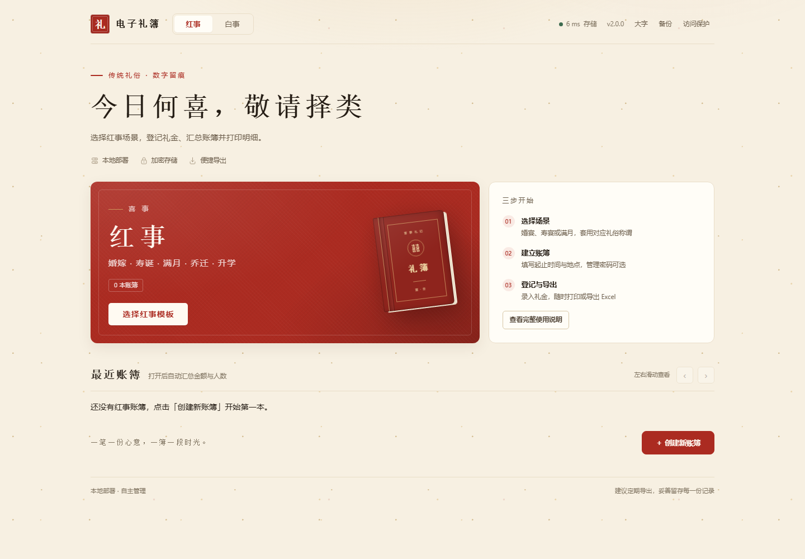
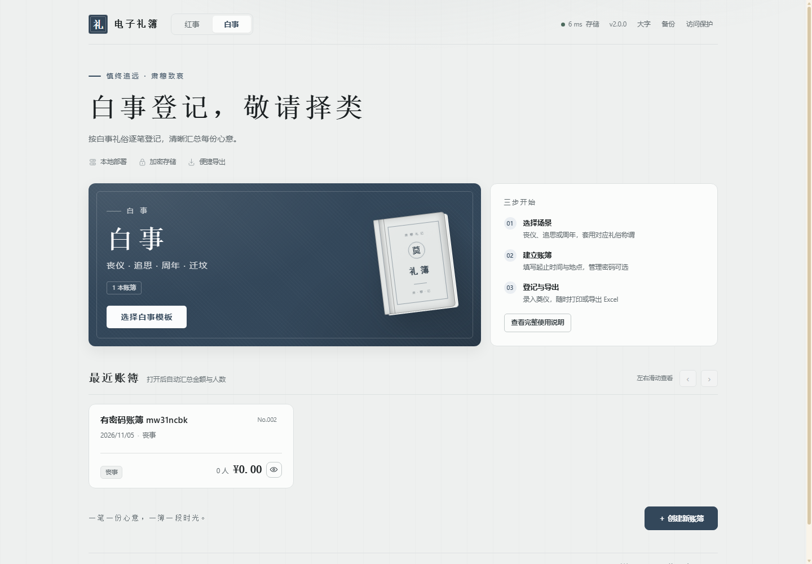
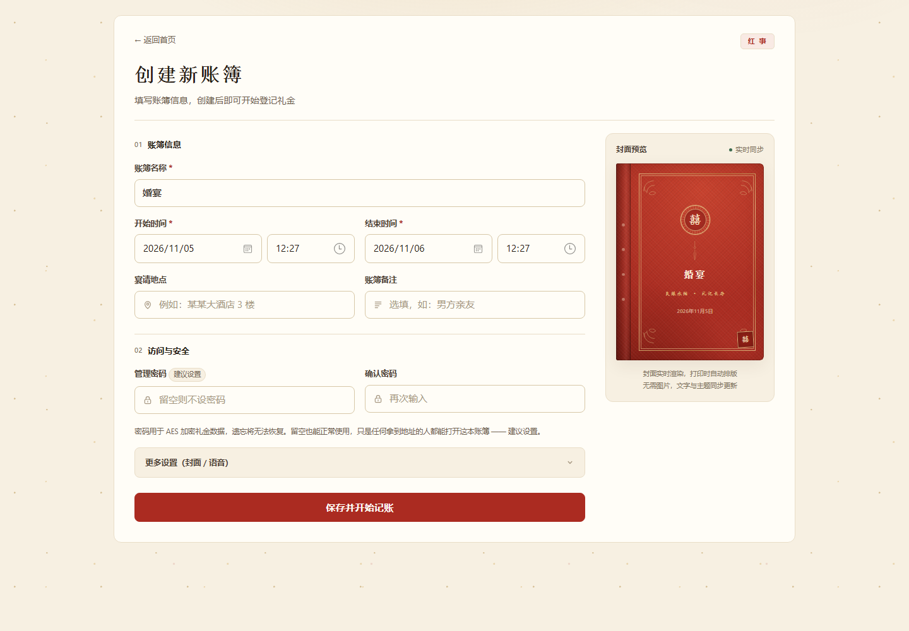
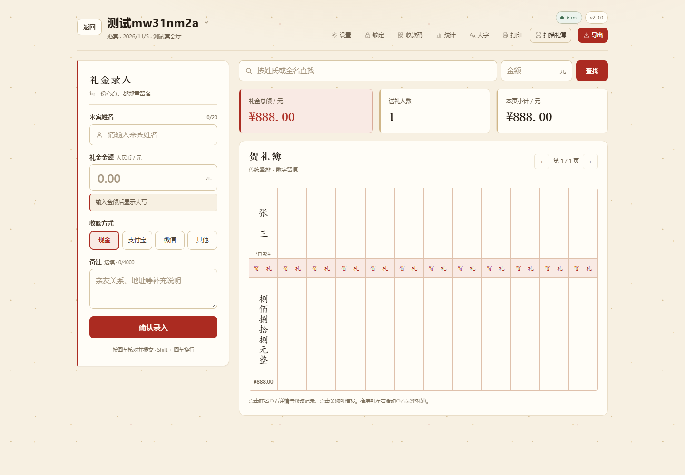
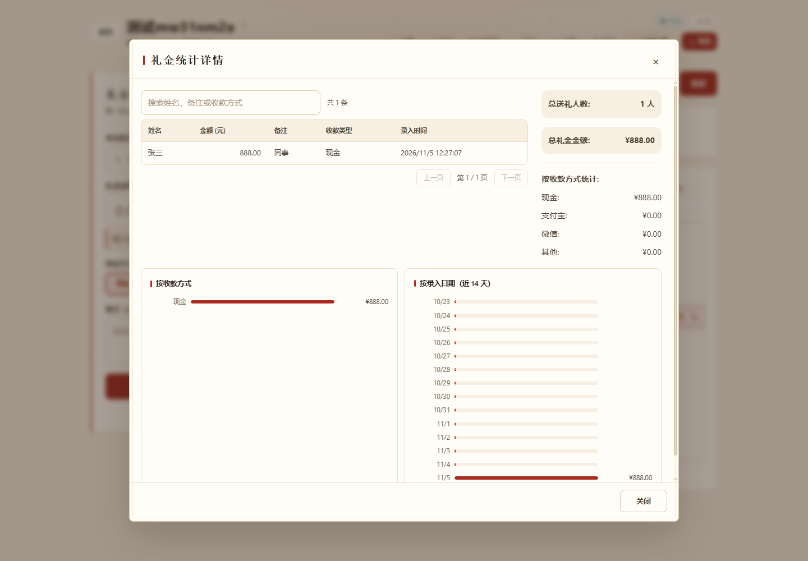
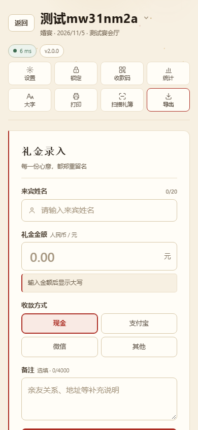

# 电子礼簿 · Gift Book

红白喜事礼金登记，数据全部保存在本机。单文件或单容器即可运行：内嵌前端、纯 JSON 存储，无数据库、无外部服务、无需注册。

> 由旧版（PHP 单页）重写而来：界面与流程保持一致，后端改为 Go（纯标准库），前端改为零第三方依赖的自研原生 JS/CSS。OCR 识别保留第三方组件，见 `ocr/THIRD_PARTY.md`。

## 特性

- **隐私优先**：礼金在浏览器端加密后上传，服务端只存密文，不接触明文
- **红白双主题**：红事「囍」、白事「奠」两套配色与封面，互不串色
- **竖排礼簿**：传统竖排，金额实时转大写，同名 / 同额自动提醒
- **封面模板**：模板 5 + 5，封面 9 款，CSS / SVG 现画，不含图片素材
- **记录留痕**：只改不删，每次纠错留快照，详情可看时间轴
- **导出打印**：Excel 明细、A4 横向 PDF、Word；字号与页边距可调
- **扫描录入**：可选 OCR，拍照识别后加密导入
- **离线可用**：断网暂存，恢复后按 `requestId` 去重补传
- **安全防护**：整站访问密码 + 账簿管理密码 + IP 防爆破
- **备份迁移**：一键导出整站 zip，换机即恢复

## 界面预览

| 红事首页 | 白事首页 |
| --- | --- |
|  |  |

| 新建账簿 | 记账页 |
| --- | --- |
|  |  |

| 统计 | 手机端 |
| --- | --- |
|  |  |

---

## 快速开始

### 方式一：直接运行二进制

```bash
# Windows
giftbook.exe

# Linux x86_64
./giftbook-linux-amd64

# Linux ARM64（NAS、树莓派）
./giftbook-linux-arm64
```

浏览器打开 `http://<机器IP>:8099`。账簿数据默认写到可执行文件旁的 `data/`，认证配置、自动备份包等其余文件写到旁的 `config/`。

### 方式二：Docker 部署

公开镜像已发布到 GitHub Container Registry，新建 `docker-compose.yml` 粘贴以下内容即可部署，无需下载源码：

```yaml
name: gift-book

services:
  gift-book:
    image: ghcr.io/1316195118/gift-book:latest            # 公开镜像，免登录直接拉取
    container_name: gift-book                               # 容器名
    user: "1000:10"                                         # 权限：以 UID:GID 运行（绿联 UGOS Pro 首用户为 1000:10）
    ports:
      - "8099:8099"                                         # 宿主机:容器 端口映射
    environment:
      - TZ=Asia/Shanghai                                    # 时区
      # - GIFTBOOK_SETUP_TOKEN=change-me                    # 首次开启访问保护时要求的口令
      # - GIFTBOOK_TRUST_PROXY=1                            # 位于受信任反向代理后开启
    command:
      - -addr
      - 0.0.0.0                                             # 监听地址（接受局域网访问）
      - -port
      - "8099"                                              # 监听端口
      - -data
      - /data                                               # 账簿数据目录（容器内）
      - -config
      - /config                                             # 配置、自动备份包目录（容器内）
    restart: unless-stopped                                 # 容器策略：开机自启 + 异常重启
    volumes:
      - /volume1/docker/gift-book/data:/data                # 账簿数据持久化
      - /volume1/docker/gift-book/config:/config            # 认证状态、自动备份包等持久化
    deploy:
      resources:
        limits:
          cpus: "2"                                         # CPU 核数上限
          memory: 512M                                      # 内存上限
    healthcheck:
      test: ["CMD", "wget", "-qO-", "http://127.0.0.1:8099/api/ping"]
      interval: 30s
      timeout: 10s
      retries: 3
      start_period: 10s
```

```bash
docker compose up -d
```

浏览器打开 `http://<机器IP>:8099`。

- 镜像使用 `latest` 标签（带 shell 与 `wget` 的 Alpine 精简镜像，健康检查开箱即用）；如需锁定版本可用 `alpine-20261106`。
- 普通 Linux / Windows / 其他 NAS：把 `volumes` 两行改成 `./data:/data`、`./config:/config`，删掉 `user` 行，`deploy` 一段可整体删除。
- 账簿数据与其余文件分别持久化在两个目录，升级容器不会丢数据：

| 容器目录 | 宿主机目录 | 用途 |
| --- | --- | --- |
| `/data` | `/volume1/docker/gift-book/data` | 账簿数据（`events.json`、`gifts_*.json`、`.trash/`） |
| `/config` | `/volume1/docker/gift-book/config` | 认证状态、自动备份设置与备份包、其余非数据文件 |

也可以直接用 `docker run`：

```bash
docker run -d --name gift-book \
  -p 8099:8099 \
  -v "$(pwd)/data:/data" \
  -v "$(pwd)/config:/config" \
  -e TZ=Asia/Shanghai \
  --restart unless-stopped \
  ghcr.io/1316195118/gift-book:latest
```

如需自行构建镜像（需要 Docker；前端已内嵌，Dockerfile 只需编译 Go，无需 Node/npm）：

```bash
git clone https://github.com/1316195118/gift-book.git
cd gift-book
docker build -t gift-book:latest .
```

### 方式三：从源码构建

需要 Go 1.24+；Node 仅用于生成构建号（也可直接 `go build`，此时构建号显示为 `dev`）：

```bash
build.bat          # Windows：编译 giftbook.exe
./build.sh         # Linux/macOS：产出无后缀的 giftbook
```

前端 `ui/` 是自研原生 JS/CSS，由 `//go:embed all:ui` 直接嵌入二进制，**没有 npm install、没有打包步骤**。产物落在仓库根目录：Windows 是 `giftbook.exe`，Linux/macOS 是 `giftbook`（发布包里的 `giftbook-linux-amd64` 等是另行交叉编译重命名的）。

或分步：

```bash
node scripts/build.mjs        # 写 ui/build.json 构建号 → go build
# 或最简：go build -o giftbook ./cmd/giftbook
```

### 常用参数

| 参数 | 默认值 | 说明 |
| --- | --- | --- |
| `-port` | `8099` | 监听端口 |
| `-addr` | `0.0.0.0` | 监听地址，只给本机用可设 `127.0.0.1` |
| `-data` | 可执行文件旁的 `data/` | 账簿数据目录，只放 `events.json`、`gifts_*.json`、`.trash/` |
| `-config` | 可执行文件旁的 `config/` | 认证状态、自动备份设置与备份包、其余非数据文件 |
| `-open` | 关闭 | 启动后自动打开浏览器 |
| `-version` | — | 打印版本 |

环境变量 `GIFTBOOK_DATA_DIR` / `GIFTBOOK_CONFIG_DIR` 等价于对应参数。

**旧版 `rundata/` 自动迁移**：使用默认目录启动时，若可执行文件旁存在旧的 `rundata/`，且 `data/events.json` 尚不存在，启动时会把 `events.json`、`gifts_*.json`、`.trash/` 复制到 `data/`，把认证状态、自动备份设置、`backups/` 等其余文件复制到 `config/`。迁移只复制、不删除、不覆盖已有文件，`rundata/` 原样保留，确认无误后可自行归档；之后每次启动检测到 `data/events.json` 已存在就自动跳过。显式指定 `-data` / `-config` 或对应环境变量时视为自定义部署，不自动迁移，需自行把旧文件放进对应目录。

---

## 数据与安全

### 存储

纯 JSON 文件。`data/` 只放账簿数据，`config/` 放其余全部文件，两个目录可分别挂载、分别备份：

```
data/
├── events.json                   账簿清单
├── gifts_<eventId>.json          单本账簿的礼金（只含密文）
└── .trash/                       删除的账簿、导入前的旧数据

config/
├── auth-state.json               访问保护状态
├── auth-throttle.json            登录失败计数
├── autobackup.json               自动备份设置
├── backups/                      定时备份包（auto-*.zip）
└── ...                           其余非数据文件
```

指向旧版 PHP 部署的 `data/` 目录仍可直接读取既有账簿（用 `-data` 指过去即可），账簿格式本身没有变化。

每次写入都是「写临时文件 → fsync → 原子改名」，断电最多回到上一版完整文件。

### 加密

- 礼金内容由**浏览器**用管理密码加密后上传，服务端只存密文，从不接触明文。
- v2 格式：PBKDF2-SHA256(310k) 派生密钥 → AES-256-CBC + HMAC-SHA256（先加密后认证）。
- 旧版 `Salted__`（EVP_BytesToKey/MD5）密文仍可解开，打开账簿后逐笔自动升级。
- 管理密码丢失无法恢复；接口从不回传可离线比对的摘要。

### 接口安全

- 所有写接口校验同源 `Origin`，跨站请求直接 403。
- 账簿钥匙走 `X-Ledger-Key` 请求头，服务端存 `HMAC-SHA256(钥匙, 每本随机盐)`。
- 访问密码与账簿钥匙的连续输错共用 IP 防爆破，锁定时间指数增长（1→30 分钟）。
- 静态资源与接口分离，API 一律 `no-store`。

首次部署时，从「未开启访问保护」到「开启」这一步默认无需额外验证，局域网内任何能打开页面的人都可以抢先设置密码。部署到不受信任的网络时，建议设置环境变量 `GIFTBOOK_SETUP_TOKEN`（任意足够长的口令）：设置后开启访问保护必须同时提供该口令，界面会显示「设置口令」输入框。位于受信任反向代理之后时，可再设 `GIFTBOOK_TRUST_PROXY=1` 让 `X-Forwarded-For` 参与防爆破与 Cookie 的 HTTPS 判断。

写接口的同源校验默认沿用旧版行为（只比主机名、忽略端口），方便同机不同端口的前端与开发代理。如果这台机器上还跑着其他不可信的 Web 服务，可设 `GIFTBOOK_STRICT_ORIGIN=1` 收紧为 `host:port` 完全一致，堵住同机跨端口的跨站写请求；开启后，从其他端口访问的前端必须经反向代理（或由开发代理改写 `Origin`）才能写入。

### 备份

页面「设置 → 数据备份」里导出 / 导入；也可直接把两个目录一起打包：

```
tar czf giftbook-backup-$(date +%F).tgz data/ config/
```

只要账簿数据就只打包 `data/`；`config/` 里是认证状态与自动备份包，换机恢复时按需带上。

---

## 扫描礼簿（可选）

OCR 引擎不在二进制里。默认读取可执行文件旁的 `ocr/` 目录：

```
ocr/
├── recognize.py        # 输入图片路径，stdout 输出 {"success":true,"data":{"lines":[...]}}
└── venv/bin/python     # 或 Windows 的 venv\Scripts\python.exe
```

也可用环境变量 `GIFTBOOK_OCR_PYTHON`、`GIFTBOOK_OCR_SCRIPT` 指定。未配置时界面会明确提示「当前部署未内置 OCR」，其余功能不受影响。

---

## 目录结构

```
cmd/giftbook/        Go 入口（参数、嵌入资源、旧 rundata/ 迁移、优雅退出）
internal/api/        HTTP 接口、静态资源、OCR 桥接、备份
internal/auth/       访问保护、Cookie、防爆破
internal/ledger/     账簿管理密码校验
internal/store/      JSON 文件存储（原子写、事务、回收站）
ui/                  自研前端源码（原生 ES Modules + CSS，零依赖，Go embed 目录）
ui/app.js            根控制器：页面切换与全局浮层
ui/views/            首页 / 模板 / 创建 / 记账四个页面
ui/components/       弹窗、离线提示、收款码、访问闸门
ui/lib/              自研逻辑库（加解密、离线队列、导出、打印、OCR 等）
ui/styles/           设计系统 CSS（沿用旧版视觉，含大字/打印/动效）
scripts/build.mjs    统一构建脚本
scripts/api-test.mjs 接口端到端测试
scripts/ui-check.mjs 无头浏览器界面验证
```

---

## 测试

```
node scripts/api-test.mjs      # 建账 / 加密礼金 / 并发保护 / 备份恢复 / 非法输入
node scripts/ui-check.mjs      # 22 项界面验证
node scripts/theme-sweep.mjs   # 红白两套主题逐页截图 + 串色 / 用词检查
node scripts/layout-audit.mjs  # 版面体检：重叠 / 挡字 / 裁切 / 隐形 / 素材不等大 / 对比度
node scripts/print-proof.mjs   # 打印打样：出 A4 横向 PDF + 分页图，查溢出与串色
node scripts/smoke.mjs <url>   # 只读冒烟，用来验线上部署（不建任何账簿）
```

`api-test.mjs` 会断言数据目录里只有它自己建的账簿，所以要对着一个空目录的实例跑：

```bash
./giftbook.exe -addr 127.0.0.1 -port 18299 -data /tmp/gb -config /tmp/gb &
BASE=http://127.0.0.1:18299 node scripts/api-test.mjs
```

`layout-audit.mjs` 把 13 个页面 / 弹窗 × 红白两套 × 桌面和手机两个宽度共 52 种组合走一遍，
按几何和计算样式找七类毛病，比肉眼翻截图稳。`print-proof.mjs` 可以用
`PRINT_FONT=xlarge PRINT_MARGIN=wide` 验证极端排版设置下版心不会被撑破。

### 部署到测试机

把程序推到 Proxmox 宿主机下的 LXC 容器里。脚本会先探测目标容器是否存在：存在则按 Docker 方式部署，否则回退到旧的 systemd 服务方式。

```bash
PVE_HOST=192.168.1.10 GB_PW='<root 密码>' scripts/deploy-pve.sh
```

写入构建号 → 交叉编译 linux/amd64 → scp 到宿主机 → **停容器**（二进制正在执行，直接覆盖会报 `Text file busy`）→ `pct push` 替换 → `docker compose up -d` → 健康检查。

| 变量 | 必填 | 默认 | 说明 |
| --- | --- | --- | --- |
| `PVE_HOST` | 是 | — | Proxmox 宿主机地址 |
| `GB_PW` | 是 | — | 宿主机 root 密码，只从环境变量读，不写进仓库 |
| `PVE_USER` | | `root` | 登录宿主机的用户 |
| `CT_ID` | | `100` | 目标 LXC 容器编号 |
| `DOCKER_DIR` | | `/opt/gift-book-docker` | 容器内 compose 目录（容器部署用） |
| `CONTAINER` | | `gift-book` | 容器名，存在则走容器部署 |
| `REMOTE_BIN` | | `/opt/giftbook-go/giftbook` | 仅 systemd 回退时用：程序路径 |
| `SERVICE` | | `giftbook` | 仅 systemd 回退时用：服务名 |
| `APP_URL` | | 不检查 | 设了就在更新后请求一次确认返回 200 |

版面体检还支持压力场景（超窄屏 / 大字 / 长文本 / 动画开启）：

```bash
AUDIT_WIDTHS=320,768 LARGE_TEXT=1 STRESS=1 MOTION=no-preference \
  node scripts/layout-audit.mjs http://127.0.0.1:18099/
```

两个界面脚本都通过 CDP 驱动浏览器，先开一个带调试端口的实例：

```bash
msedge --headless=new --remote-debugging-port=9334 --user-data-dir=/tmp/edge-ui about:blank
```

调界面不需要打包工具链：`ui/` 是浏览器直接加载的原生 ES Modules，改完源码重新 `go build` 一次即可（秒级）。若想完全跳过编译，可用任意静态服务器托管 `ui/` 并把 `/api` 反代到已运行的后端（例如 `./giftbook -port 18099`）；注意 ES Modules 必须经 HTTP 加载，不能用 `file://` 直接打开 `index.html`。

---

## 许可证

MIT。全部源码自写；`ocr/` 目录只包含本项目自写的调用代码与依赖版本声明。

OCR 依赖的第三方组件**不随本仓库分发**，各自按其许可证单独授权：RapidOCR 与 PP-OCRv5 模型为 Apache-2.0，ONNX Runtime 为 MIT，其余 Python 依赖见各自发行包。完整清单、出处，以及构建镜像时必须保留的许可文本/NOTICE 要求见 `ocr/THIRD_PARTY.md`。模型文件与 `venv/` 已由 `.gitignore` 排除，请勿提交第三方二进制。

## 自动备份

首页右上角「自动备份」可开启定时备份：按 1 小时 / 6 小时 / 12 小时 / 每天 / 每周把全部账簿打包成 zip，存到配置目录的 `config/backups/`，按设定份数自动清理旧文件，也可随时点「立即备份一份」或单独下载某一份。

设置存在配置目录的 `autobackup.json`，不含任何密钥；备份包与设置同在 `config/`，`data/` 里不会出现任何非账簿文件。

## 界面定制

样式按职责分层，加载顺序就是层叠顺序（见 `ui/index.html`），后面的文件只做加法：

| 文件 | 负责 |
| --- | --- |
| `styles/tokens.css` | 设计令牌：两套主题的色阶、字号、间距、圆角、动效曲线 |
| `styles/base.css` | 重置、排版、焦点环、可访问性 |
| `styles/atmosphere.css` | 纸张底纹与光、印章、进场与落印动效 |
| `styles/utilities.css` | 少量通用原子类 |
| `styles/components.css` | 按钮、输入框、弹窗、开关等公共组件 |
| `styles/screens.css` | 首页 / 模板页 / 创建页 / 记账页的版面 |
| `styles/cover.css` | 礼簿封面（屏幕、预览、打印共用一套） |
| `styles/ocr.css`、`styles/print.css` | 扫描界面、打印版式 |
| `styles/motion.css` | 动效与「减弱动态效果」适配（叠加层） |
| `styles/design.css` | 大字模式、弹窗细节等最终覆盖（叠加层，必须最后加载） |

改配色只动 `tokens.css`；改版面动 `screens.css`；改封面动 `cover.css`。`motion.css` 与 `design.css` 是最后加载的覆盖层，调整样式层级时不要把它们前移。

### 动效与交互反馈

动效统一收在 `motion.css`（交互反馈与节奏层），逻辑在 `ui/lib/feedback.js`，零第三方依赖：

- **页面切换**：`app.js` 按页面层级给 `#view-root` 写 `data-direction`，往里走从右侧进入、返回首页从左侧回、进入记账页是「翻开账簿」的略重位移。
- **点击反馈**：全局涟漪用独立一层裁剪（宿主只加 `position: relative`，不改 `overflow`，不会切掉下拉菜单）；按钮悬停抬升、按下沉降沿用原有物理反馈。
- **操作提示**：`notify / success / info / warn / error` 生成右上角堆叠 toast，最多三条、带进度条、悬停暂停、可手动关闭。错误仍用弹窗（更醒目），toast 只报成功与状态变化。
- **异步与数值**：`withBusy()` 统一处理按钮禁用、忙碌文案与 spinner；`pulse()` 用于总额变化、封面选定等「值变了」的强调；礼簿翻页按方向做一次落纸反馈。
- **降级**：`prefers-reduced-motion: reduce` 与打印时，新增动效全部关闭（涟漪不生成、toast 不做位移、spinner 静态），`base.css` 另把所有时长归零。

### 两套主题互不借色

红事取**洒金宣纸 + 朱砂 + 赤金**，白事取**素宣 + 青黛 + 素银**。
白事页面不出现红与金（连「删除」按钮也用暖炭色而非红色），红事页面不使用青黛系冷色 ——
石青虽然在传统彩画里与朱金同席，但它和白事主色太接近，会让人误以为打开错了账簿。

`node scripts/theme-sweep.mjs` 会把两套主题的 13 个页面与弹窗各走一遍，
自动检查**串色**（计算样式里出现对方主题的色相）和**用词**（白事页面出现喜庆字眼，或反之），
并逐页截图到 `.shots/sweep/`。
