<div align="center">

# 电子礼簿 · Gift Book

**红白喜事记礼金，数据只留在你自己的 NAS 上。**

一套自托管的电子礼簿：竖排姓名、大写金额、可打印的封面与印章，全部由代码渲染；没有云端、没有账号、没有遥测。

[](LICENSE)
[](https://www.php.net/)
[](docker-compose.yml)
[](#零前端依赖)
[](#手机端)

[功能亮点](#功能亮点) · [界面预览](#界面预览) · [Docker 部署](#docker-部署) · [数据与安全](#数据与安全) · [常见问题](#常见问题) · [免责声明](#免责声明)

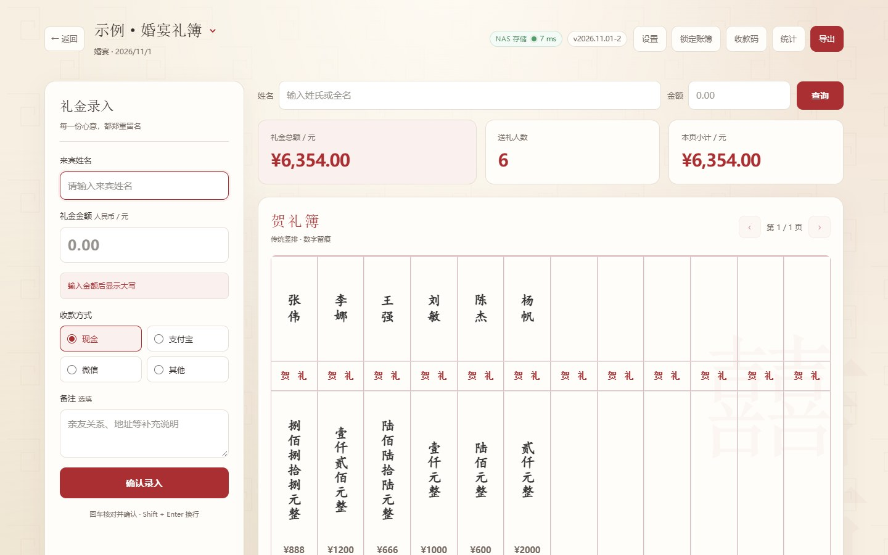

</div>

---

## 为什么是它

纸礼簿好在仪式感，坏在算错、看不清、丢了没法补。Excel 好在能算，坏在酒席上不方便、多人不能同时记、样式也拿不出手。

这套电子礼簿想同时拿到两边的好处：

| 常见痛点 | 这里的做法 |
| --- | --- |
| 云端礼簿要注册、要联网、怕数据外泄 | 单容器自托管，数据就是一个 `data/` 目录，**不联外网也能记账** |
| 现场网络差，记一半提交失败就丢了 | 断网自动**加密暂存本机**，来网后按顺序补传，右下角随时可看 |
| 红事白事混在一起，风格乱 | 红 / 白两套主题与封面完全隔离，**同一套功能、只换风格** |
| 宴席上打字慢、怕记错 | 姓名 + 金额 + 收款方式，回车核对，**语音播报**确认 |
| 事后统计、打印、发群里 | 一键导出 **Excel 明细** 或 **A4 竖排 PDF 礼簿**（含封面、印章） |
| 用别人的模板怕版权 | 封面、纹样、印章全部 CSS/SVG **现画**，仓库里没有一张素材图 |
| 第三方库越来越多、越更越慢 | 前端 **零依赖**：样式底座、AES/SHA-256、XLSX 写出都是自己写的 |

---

## 功能亮点

### 记账

- **礼金登记**：姓名、金额、收款方式（现金 / 支付宝 / 微信 / 其他）、备注；金额实时转大写。
- **重复提醒**：同名或同名同额会先提示，避免手滑记两遍。
- **查询**：按姓名（可只输姓氏）或金额查，两个条件可单用。
- **汇总**：礼金总额、送礼人数、本页小计；金额默认打码，点小眼睛才显示。
- **锁定**：开席后一键锁定，解锁需管理密码。
- **语音播报**：内置 **72 个中文音色**（普通话 + 26 个地区，男女各一），可设起报金额。

### 红白双主题

- 红事「囍」暖红、白事「奠」肃穆灰，**功能完全一致，只有风格不同**。
- 封面样式按分类隔离：红事 6 款、白事 3 款，互不串场。
- 模板固定 5 + 5（婚宴 / 寿宴 / 满月 / 乔迁 / 升学；丧事 / 白事 / 追思 / 周年 / 迁坟）。

### 导出与打印

- 一个「导出」按钮，弹窗里选 **Excel 明细** 或 **PDF 礼簿**。
- PDF 用浏览器打印生成：A4 横向、含封面页、竖排姓名、大写金额、页脚汇总。

### 断网也能记

- 记账时检测三条链路（账簿接口 / 静态资源 / 登录状态），断了会在**右下角**弹出提示，写明是哪条断了。
- 记录用当前密码**加密后**暂存在浏览器，网络恢复自动补传；礼簿里标 `*待同步`，标题旁有呼吸徽标。
- 联网时所有接口请求 `no-store`，不读浏览器缓存，拿到的永远是 NAS 上的最新数据。

---

## 界面预览

<table>
  <tr>
    <td width="50%">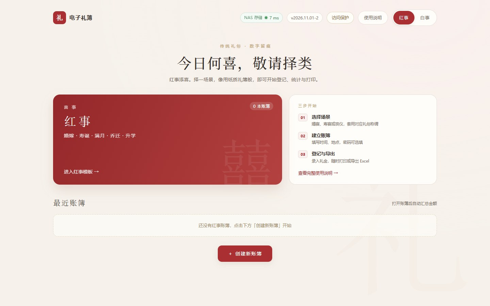<br><sub>首页：红 / 白分类，最近账簿</sub></td>
    <td width="50%">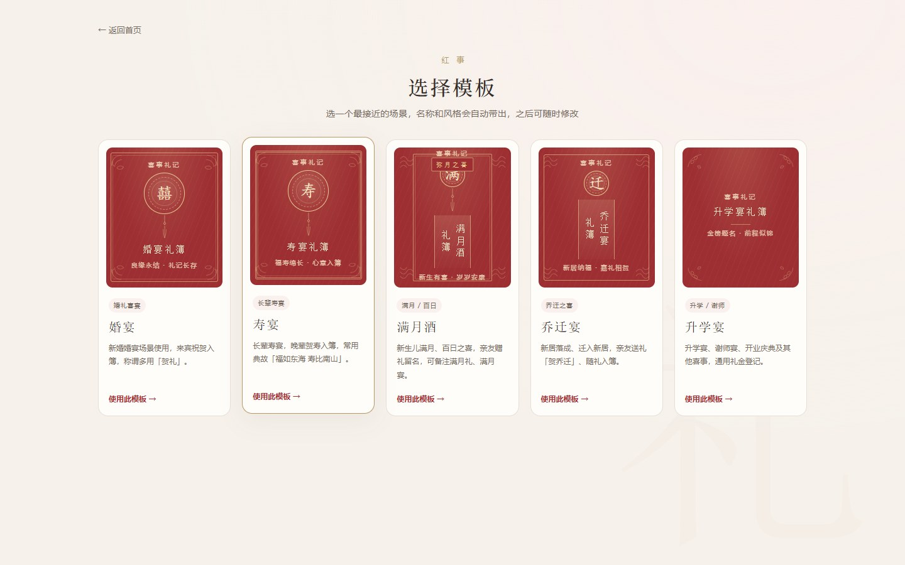<br><sub>模板页：每个场景一套自绘封面</sub></td>
  </tr>
  <tr>
    <td>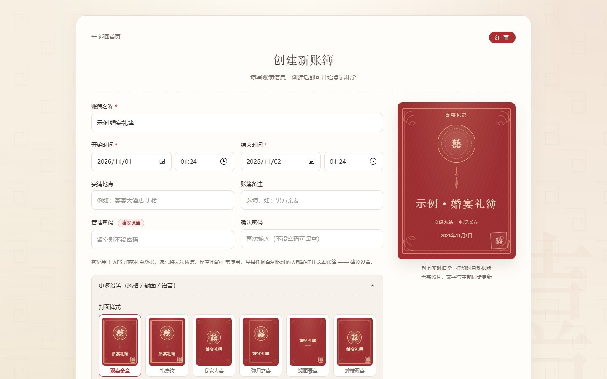<br><sub>创建页：封面实时预览，9 款样式可选</sub></td>
    <td>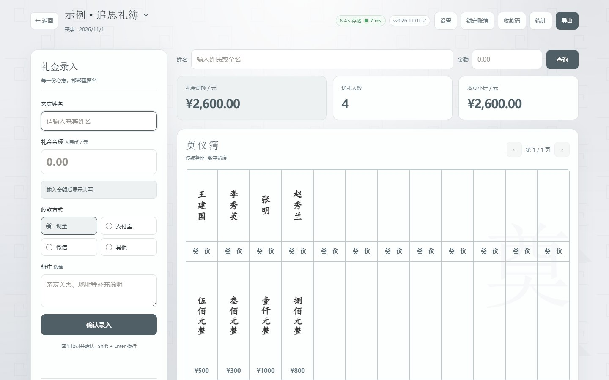<br><sub>白事：同一套布局，只换风格</sub></td>
  </tr>
  <tr>
    <td>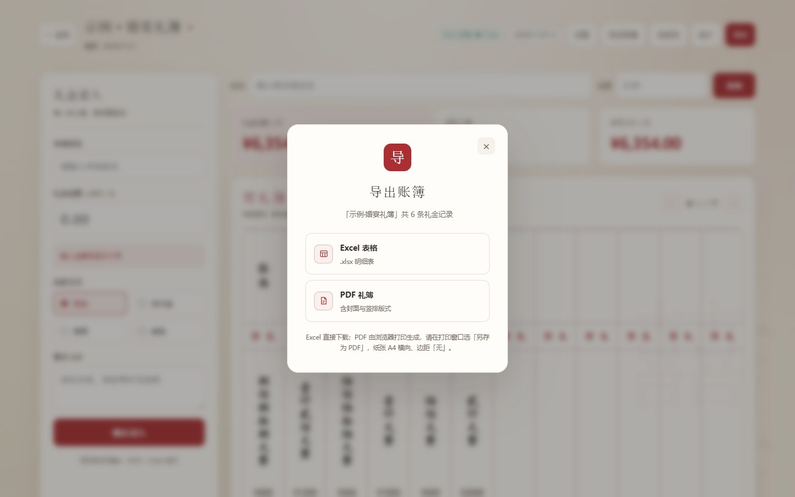<br><sub>导出：Excel 明细 / PDF 礼簿</sub></td>
    <td>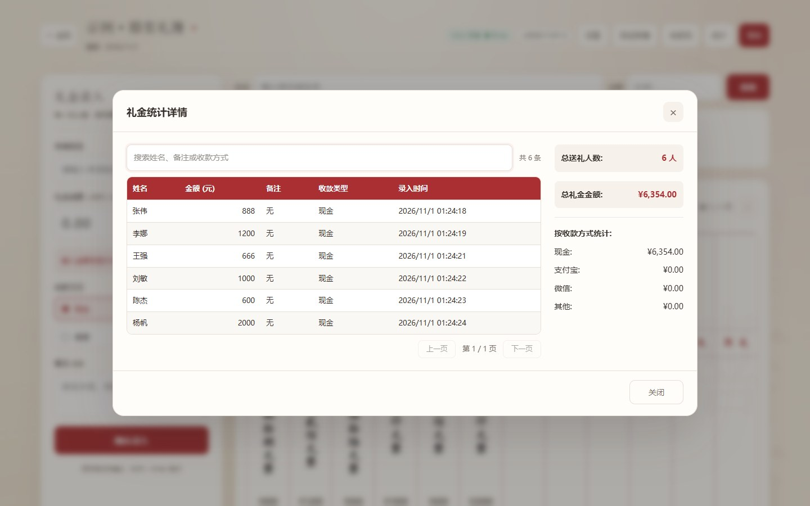<br><sub>统计：搜索、排序、分页</sub></td>
  </tr>
  <tr>
    <td>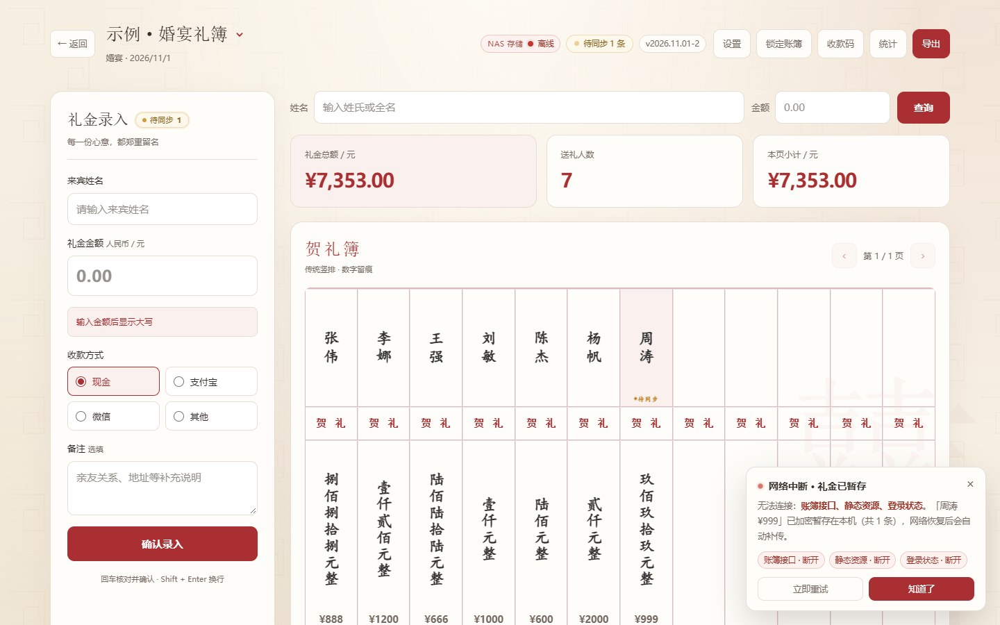<br><sub>断网：右下角提示 + 本机加密暂存</sub></td>
    <td>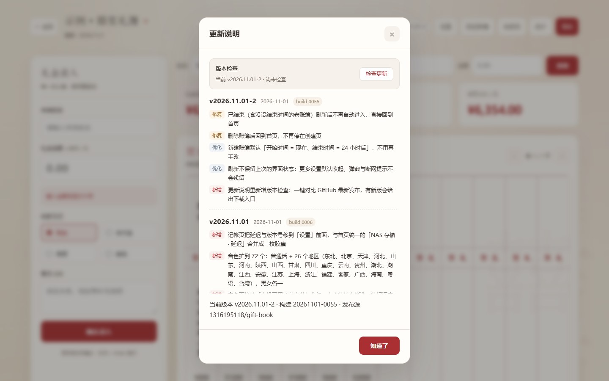<br><sub>版本检查：对比 GitHub 最新发布</sub></td>
  </tr>
</table>

<p align="center">
  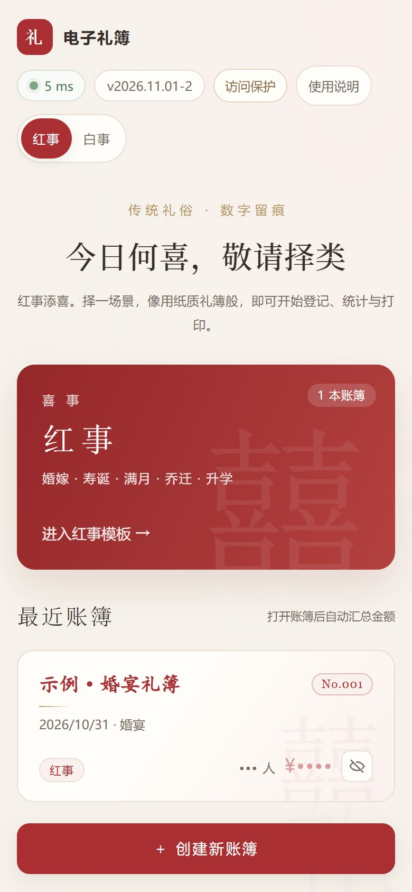
  &nbsp;&nbsp;
  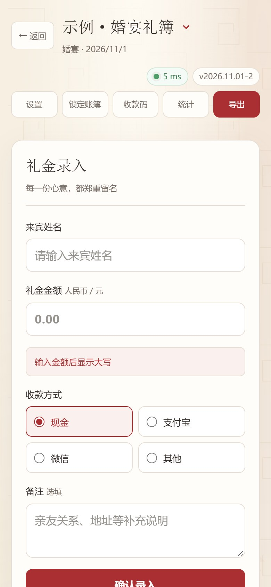
</p>

---

## Docker 部署

推荐用 Docker Compose 部署，三条命令就能跑起来；下面同时给出 compose 全文与参数说明。

### 前置要求

- Docker 20.10+ 与 Docker Compose V2（`docker compose version` 能输出版本号）
- 一台能长期开机的机器：NAS、小主机、树莓派、云服务器都行
- 默认占用 `8099` 端口，可按需修改

### 1. 获取代码

```bash
git clone https://github.com/1316195118/gift-book.git
cd gift-book
```

仓库里已经带好 `Dockerfile`、`docker-compose.yml` 与网页文件，**开箱即用，不用改**。

如果只想手抄一个 `docker-compose.yml`（不克隆仓库），记得把 `Dockerfile` 和网页文件也放到同目录，否则 `build: .` 没有构建上下文。仓库自带的 compose 长这样：

```yaml
services:
  gift-book:
    # 镜像名带作者命名空间；本地没有时会按下面的 build 现场构建（约 15 秒）
    image: 1316195118/gift-book:latest
    build: .
    container_name: gift-book
    # 桥接网络即可；本项目不依赖局域网组播
    network_mode: "bridge"

    environment:
      # 容器内 www-data 的 UID/GID，与宿主机对齐，挂出来的 data/ 才不会变成 root 所有
      - PUID=${PUID:-1000}
      - PGID=${PGID:-1000}
      # 时区：影响账簿记录与导出的时间
      - TZ=${TZ:-Asia/Shanghai}
      # UTF-8 环境，中文不会乱码
      - LANG=C.UTF-8
      # 数据目录，与下面的 volumes 保持一致
      - GIFTBOOK_DATA_DIR=/var/www/html/data/

    volumes:
      # 账簿数据：唯一需要备份的目录，容器重建不丢
      - ./data:/var/www/html/data
      # 想直接改页面（不重建镜像）时打开这行，把仓库文件放到 ./www
      # - ./www:/var/www/html

    ports:
      # 宿主机端口:容器端口，改端口只改左边的 ${PORT}
      - "${PORT:-8099}:80"

    # 资源上限（Compose V2 直接生效），不想要就整段删掉
    deploy:
      resources:
        limits:
          cpus: "2"
          memory: 512M

    healthcheck:
      test: ["CMD", "php", "-r", "exit(@fsockopen('127.0.0.1', 80) ? 0 : 1);"]
      interval: 30s
      timeout: 5s
      retries: 3
      start_period: 20s

    # 开机自启；手动 docker compose stop 之后不会自己爬起来
    restart: unless-stopped
```

### 2. 配置环境变量（可选）

```bash
cp .env.example .env
vi .env
```

```dotenv
# 宿主机端口，浏览器访问 http://NAS_IP:8099
PORT=8099
# 时区
TZ=Asia/Shanghai
# 容器内运行用户，群晖 / 绿联一般是 1000:1000；Linux 用 id -u / id -g 查
PUID=1000
PGID=1000
```

四项都有内置默认值，**不写 `.env` 也能直接启动**。

### 3. 启动服务

```bash
docker compose up -d --build
```

首次会用仓库里的 `Dockerfile` 构建镜像并打上 `1316195118/gift-book:latest` 标签，约 15 秒；之后重启都是秒起。

```bash
docker compose ps          # 看状态，healthy 即正常
docker compose logs -f     # 跟踪日志
```

### 4. 访问

浏览器打开 `http://<机器IP>:8099`：

1. 首页选「红事」或「白事」→ 挑一个场景模板
2. 填账簿名称；**管理密码可留空**（留空则任何拿到地址的人都能打开，建议设置）
3. 「更多设置」里可选封面样式、上传自己的封面、挑语音
4. 开始记账；结束后「导出」拿 Excel 或 PDF

> 页面右上角有版本号，点开「检查更新」可以直接对比 GitHub 上的最新发布。

### 5. 数据持久化

| 宿主机路径 | 容器路径 | 说明 |
| --- | --- | --- |
| `./data` | `/var/www/html/data` | 账簿清单 `events.json`、礼金密文 `gifts_<id>.json`、访问保护配置；**唯一需要备份的目录** |

```bash
# 备份（建议每次办完事备一份）
tar czf gift-book-$(date +%F).tgz data/

# 恢复
tar xzf gift-book-2026-11-01.tgz

# 换机器：把整个目录拷过去，再 docker compose up -d 即可
```

> 容器重建、镜像升级都不会碰 `./data`；管理密码忘了礼金就解不开，密码请和备份放一起。

### 6. 升级

```bash
cd gift-book
git pull
docker compose up -d --build
```

只更新页面、不动镜像时，也可以只覆盖 `index.html` 与 `static/`，刷新浏览器即生效（页面已禁用缓存，并带构建号自愈）。

### 环境变量

| 变量 | 默认值 | 说明 |
| --- | --- | --- |
| `PORT` | `8099` | 宿主机端口；被占用就换一个，如 `18099` |
| `TZ` | `Asia/Shanghai` | 时区，影响记录时间与导出文件名 |
| `PUID` | `1000` | 容器内 `www-data` 的 UID；NAS 上一般是 `1000`，Linux 用 `id -u` 查 |
| `PGID` | `1000` | 同上，用户组；用 `id -g` 查 |
| `LANG` | `C.UTF-8` | UTF-8 环境，保证中文不乱码 |
| `GIFTBOOK_DATA_DIR` | `/var/www/html/data/` | 容器内数据目录，改这里要同步改 volumes |

> **为什么要有 PUID/PGID？** 容器默认以 root 跑的话，挂出来的 `data/` 会变成 root 所有，宿主机上普通账号删不掉、备份工具也读不了。启动脚本会把 `www-data` 改成你指定的 UID/GID，再 `chown` 数据目录。

### 常用命令

| 命令 | 作用 |
| --- | --- |
| `docker compose up -d --build` | 构建并后台启动 |
| `docker compose ps` | 查看容器与健康状态 |
| `docker compose logs -f --tail=50` | 跟踪日志 |
| `docker compose restart` | 重启 |
| `docker compose down` | 停止并删除容器（`data/` 不受影响） |
| `docker compose down -v` | 连匿名卷一起删（**不会删 `./data`**，这是 bind mount） |
| `docker exec -it gift-book sh` | 进容器排查 |

### 反向代理 / HTTPS

Nginx 示例：

```nginx
server {
    listen 443 ssl http2;
    server_name libu.example.com;

    ssl_certificate     /etc/nginx/certs/libu.crt;
    ssl_certificate_key /etc/nginx/certs/libu.key;

    client_max_body_size 20m;        # 上传封面图用

    location / {
        proxy_pass http://127.0.0.1:8099;
        proxy_set_header Host $host;
        proxy_set_header X-Real-IP $remote_addr;
        proxy_set_header X-Forwarded-For $proxy_add_x_forwarded_for;
        proxy_set_header X-Forwarded-Proto $scheme;
    }
}
```

群晖 / 绿联自带的反向代理面板同理：目标 `http://127.0.0.1:8099`，上传大小放到 20MB。

---

## 其他部署方式

### 已有 PHP 环境（宝塔 / 群晖 Web Station）

1. 把仓库里的 `index.html`、`static/`、`*.php`、`.htaccess` 放进站点根目录。
2. PHP 需 **8.0+**，开启 `json`、`openssl`。
3. 确保 `data/` 可写（`chmod 775`，属主为 Web 用户）。
4. 不要覆盖 `config.php` 里改过的数据目录。

### 只挂载网页目录（改样式不用重建镜像）

先把仓库文件放到宿主机目录，比如 `/volume1/docker/gift-book/www`，然后：

```yaml
    volumes:
      - /volume1/docker/gift-book/www:/var/www/html
      - /volume1/docker/gift-book/data:/var/www/html/data
```

改完 `index.html` 刷新页面即可生效，不用 `docker compose build`。

### 手动构建镜像

```bash
docker build -t 1316195118/gift-book:latest .
docker compose up -d
```

---

## 部署排查

| 现象 | 原因 / 处理 |
| --- | --- |
| 打不开页面 | `docker compose ps` 看是否 Up；`docker compose logs` 看端口是否被占 |
| 页面能开但保存报错 | `data/` 不可写：`chmod -R 775 data`，或把 `PUID/PGID` 改成 `id -u` / `id -g` 的值 |
| 中文显示成方块 | 浏览器缺中文字体，与容器无关；给系统装 Noto Sans CJK 即可 |
| 时间不对 | 改 `.env` 里的 `TZ`，`docker compose up -d` 生效 |
| 上传封面失败 | 反向代理的 `client_max_body_size` 太小，调到 20MB |
| 忘记访问密码 | 停容器，删 `data/auth-config.php` 与 `data/auth-state.json`，重启后重新设置 |
| 想换端口 | 改 `.env` 的 `PORT`，`docker compose up -d` |

## 数据与安全

| 项目 | 做法 |
| --- | --- |
| 存放位置 | 只有 `data/` 一个目录：`events.json`、`gifts_<id>.json` |
| 礼金内容 | 用管理密码派生的密钥做 **AES-256-CBC** 加密，密文格式与 OpenSSL 兼容，历史数据可直接解开 |
| 无密码账簿 | 用空密码的 SHA-256 作为哨兵值，功能不受影响 |
| 目录保护 | `.htaccess` 里 `Options -Indexes` + `data/` 直接 403，列不出文件 |
| 访问保护（可选） | 整站密码，PBKDF2-SHA256（21 万次）+ HMAC 签名 HttpOnly Cookie，7 天有效 |
| 防爆破 | 同一 IP 连错 5 次锁定，锁定时长 1→2→4→8→16→30 分钟递增 |
| 浏览器端 | 联网时**不缓存任何礼金数据**；只有断网待补传的密文会暂存在本机 |
| 遥测 | 无。除了你自己点「检查更新」会请求一次 GitHub API，页面不向外发任何请求 |

---

## 零前端依赖

`static/` 里只有五个自己写的文件，没有 CDN、没有 npm、没有第三方脚本：

| 需求 | 实现 | 说明 |
| --- | --- | --- |
| 样式底座 | `base.css` | 自己写的重置与通用类，只保留页面用到的部分 |
| 加密 | `ledger-crypto.js` | SHA-256 / MD5 / AES-256-CBC / EVP_BytesToKey，密文与 OpenSSL 互通 |
| Excel | `xlsx-lite.js` | 自写 ZIP（store）+ SpreadsheetML，产出标准 `.xlsx` |
| 音色 | `voices.js` | 72 条中文音色清单随包下发，部署后下拉框立刻可读 |
| 版式 | `refined.css` | 双主题、封面、印章、流苏，全部 CSS/SVG |

---

## 版本检查与升级

- 页面右上角的版本号（`v2026.11.01-2`）点开就是更新说明，顶部有「检查更新」。
- 它会读取本仓库的最新 Release，比当前版本新就给出「前往下载」。
- 内网部署连不上 GitHub 时会提示「暂时连不上 GitHub（内网部署可忽略）」，不影响使用。
- 升级方式：`git pull && docker compose up -d --build`，数据目录不受影响。

发布新版本时打 tag 即可：

```bash
git tag -a v2026.11.01-2 -m "v2026.11.01-2"
git push origin v2026.11.01-2
```

---

## 手机端

- 390 / 360 / 320 三档宽度都逐屏适配：工具栏 5 键单行、延迟只显示数字。
- 礼簿表格在窄屏可左右滑动，提示文案就在表下方。
- 统计弹窗小屏隐藏「录入时间」列，详情里仍能看到。

---

## 目录结构

```
.
├── index.html            # 单文件前端（含全部界面逻辑）
├── static/
│   ├── base.css          # 样式底座
│   ├── refined.css       # 双主题与版式
│   ├── ledger-crypto.js  # 自研加密（OpenSSL 兼容）
│   ├── voices.js         # 中文音色清单
│   └── xlsx-lite.js      # 自研 XLSX 写出
├── events.php            # 账簿接口
├── gifts.php             # 礼金接口
├── auth.php              # 可选访问保护 + 防爆破
├── ping.php              # 连通性探测
├── config.php            # 数据目录与 JSON 响应封装
├── data/                 # 运行期数据（默认拒绝直接访问）
├── Dockerfile
└── docker-compose.yml
```

---

## 常见问题

**Q：一定要 Docker 吗？**
不用。任何 PHP 8+ 的 Web 服务都能跑，把文件丢进去、给 `data/` 写权限即可。

**Q：密码忘了怎么办？**
礼金是用密码派生的密钥加密的，密码丢了数据**无法恢复**。请把管理密码和备份一起保管好。

**Q：能多人同时记吗？**
可以，多个浏览器同时开同一本账簿即可，写入用文件锁串行化。建议一个人主记、其他人查。

**Q：手机能用吗？**
能。390 / 360 / 320 三档宽度都适配过，工具栏单行、礼簿可左右滑动。

**Q：数据怎么备份？**
打包 `data/` 目录即可（`tar czf backup.tgz data/`）。建议每次办完事备份一份。

**Q：为什么语音里很多方言是灰的？**
朗读音频由操作系统提供。清单已内置 72 个音色，系统装了对应语音包就会自动变为可用。

---

## 许可证

[MIT](LICENSE) © 2026 Gift Book contributors

---

## 免责声明

1. 本项目仅用于**礼金登记与统计**，不构成任何法律、财务或税务建议；礼俗做法请遵循当地风俗与相关规定。
2. 所有数据保存在**使用者自己部署的服务器**上，作者**不接触、不收集、不备份**任何用户数据，也因此**不对数据丢失、损坏、泄露承担责任**——请自行做好备份与访问控制。
3. 账簿密码用于本地加密，**遗忘无法找回**；未设置密码的账簿任何拿到地址的人都能打开，请自行评估风险。
4. 请在**合法合规**的前提下使用本项目，不得用于洗钱、诈骗、行贿等违法用途；由此产生的一切后果由使用者自行承担。
5. 项目按「现状」提供，不附带任何明示或暗示的担保；使用前请自行评估是否符合你的场景。
6. 仓库中的截图均为**虚构示例数据**，与任何真实个人或事件无关。
